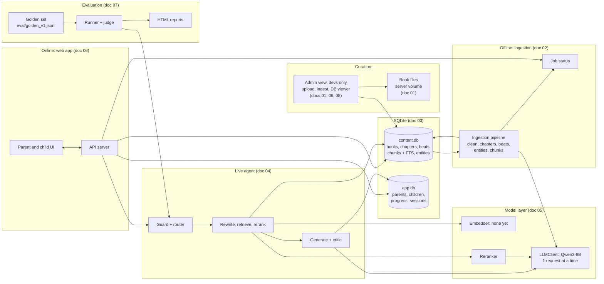

# StoryQuest Copilot — Architecture Overview

How the pieces in docs 01 to 07 fit together. Each component has its own doc; this file shows the whole system, the data flow and the phasing.

## System diagram



## Two flows

**Offline (once per book and pipeline version).** An admin uploads a book in the admin view, which stores the file and creates its `books` row. Ingestion turns the text into chapters, beats, entity cards and chunks, validating every LLM output against the source, then publishes the book.

**Live (per child turn).** The UI sends a choice or text to the API. The API loads the child's state from `app.db` and the current beat from `content.db`, and calls the agent. The agent routes the turn, retrieves position-filtered canon, generates a reply through the model layer, passes it through the critic, and the API autosaves state and returns the result.

## Responsibilities in one line each

| Component | Doc | Owns |
|---|---|---|
| Book catalog | [01](01-book-catalog.md) | What books exist and are allowed |
| Ingestion | [02](02-ingestion-pipeline.md) | Turning text into beats and searchable chunks |
| Data stores | [03](03-data-stores.md) | Schemas and the spoiler filter |
| Live agent | [04](04-live-agent.md) | A single child turn and its modes |
| Model layer | [05](05-model-layer.md) | Provider swappability, token accounting, caching |
| Web app and API | [06](06-web-app-and-api.md) | Parent and child flows, auth, progress |
| Eval harness | [07](07-eval-harness.md) | Mode comparison and reports |
| Deployment and dev environment | [08](08-deployment-and-dev-environment.md) | Docker, local run, DB viewer, secrets |
| Repository structure | [09](09-repo-structure.md) | Folder layout and dependency rules |

## Cross-cutting decisions

- **Position is the central idea.** Chapter and beat index (backed by character offsets) drive spoiler safety, retrieval filtering, resume and eval setup.
- **Beats are immutable per pipeline version.** Children keep a stable story; improvements ship as a new version.
- **One agent code path** serves the web app and the eval runner; modes are config.
- **Everything swappable sits behind an interface:** model provider, embedder, reranker, book store, database access.
- **Single server for now:** two SQLite files, one app process, a background worker for ingestion.
- **The model endpoint is the bottleneck.** One active request at a time for the whole group, 8,192 tokens per call, 1,024 output tokens, and no embeddings. This forces windowed ingestion, a global request queue, a cache, a fake provider for tests, and a critic-free MVP.

## Project Gutenberg access

There is no official API. The site's robot policy allows only the harvest endpoint, mirrors and the offline catalog. For this project: developers download a small curated set by hand and upload it through the admin view. The app never scrapes.

## Phasing

| Phase | Scope |
|---|---|
| MVP | Admin upload, ingestion via CLI or admin button with polled status, `content.db` with BM25, live agent modes M0 and M1 with the router classifier and non-LLM output check, parent login and book approval, child mission play with autosave and resume, eval runner with deterministic checks, Docker deploy and local run |
| Next | LLM judge and HTML reports, query rewrite, rerank, session cap, badges, progressive chapter publishing with sequential unlock |
| Later | Critic, embeddings and hybrid retrieval, notifications, richer UI, hosting beyond one server |

The MVP cut is a proposal and still to be confirmed.

## Proposed technology (not yet agreed)

Python for ingestion, agent and API (FastAPI-style service), SQLite with FTS5, OpenAI-compatible client for the model layer, React frontend, Docker Compose for deployment.

Proposed repo layout:

```
eval/                      golden set, reference spine, Jungle Book fixture, checks, run outputs
docs/                      requirements and design
web/                       React app
src/storyquest/
  catalog/  ingestion/  stores/  agent/  models/  api/  evaluation/  cli.py
Dockerfile  docker-compose.yml  .env.example
```

The full layout and dependency rules are in [09-repo-structure.md](09-repo-structure.md).

## Open decisions

- Auth library.
- Reading-level measure and target.
- Data retention for child turns.
- Judge model for evals.
- Whether the deployed app gets its own model key, since the group key allows one active request in total.
- Domain name and TLS for the miles web server.
- Final MVP cut (session cap, badges).
