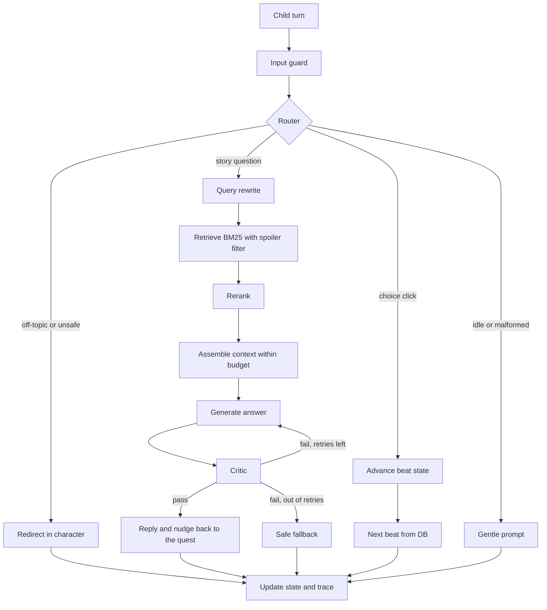

# 04 — Live Agent

Scope: what happens when a child sends a turn (a choice click or free text). The agent interprets the turn, retrieves canon when needed, replies, and updates state. It does not generate the story itself; beats are pre-built in ingestion.

## Turn flow

Each bracketed stage is optional and controlled by the mode (below).

## Implementation approach

Plain Python, no agent framework (LangGraph, CrewAI or AutoGen) for the MVP.

- A turn is a fixed sequence with a few branches. Nodes are ordinary functions that take and return a typed `TurnState` object; `agent/turn.py` is a small runner that calls them in order and follows the router's branch. Retry loops (generation, and the critic later) are explicit loops with a step cap.
- Why not a framework: the flow is simple, our model layer already owns queuing, retries, caching and token accounting, and the modes are just flags that skip nodes. A framework adds a dependency and its own abstractions over those, for a team of six to learn in four weeks.
- The planner-executor-critic requirement is met by explicit nodes and state, not by a library. Persistent state is the progress and session data in `app.db`.
- Tracing is independent of the framework: every node records its inputs, outputs, tokens and latency in our own trace format, which can be exported to Langfuse or OpenTelemetry.
- Keep nodes pure and graph-shaped (state in, state out), so a port to LangGraph later is mechanical if it starts to pay off, for example for visual graphs or checkpointing.

## Built so far (command line, modes M0 and M1)

`make ask BOOK=236 Q="..." MODE=M1 ARGS="--chapter 0 --beat 1"` runs one turn:

1. **Guard:** an empty or too-long message gets a fixed reply and never reaches the model.
2. **Router:** one small model call (JSON schema, 30 tokens) labels the message `story_question`, `feelings`, `off_topic`, `unsafe`, `injection` or `personal`. Every label except `story_question` gets a fixed, pre-written reply, with no answer written by the model.
3. **Retrieve (M1 only):** BM25 over chunks up to the child's position, top 6 (500-character chunks, so about the same text as 3 chunks of 1200; M2S on the dev split passed 70% this way against 64% with the top 3). No hits means a fixed "I don't know that yet" reply and no generation call.
4. **Generate:** one model call with the persona and rules in `agent/prompts/generate.txt`. The child's text sits between `<child_message>` markers and is declared to be data. M0 sends no passages.
5. **Output check (no model):** film and cartoon words, and names that first appear in the book after the child's position, replace the reply with a safe one. Words the child used themselves are allowed. The name list comes from the ingestion `names` stage and is a heuristic: a capitalised book term such as "Rules of the Beach" counts as a name, which can cause a harmless over-cautious reply.

The critic, rewrite and rerank are not built. Each turn records every model call (prompt, output, tokens, time) so `--verbose` shows exactly what was sent.

## Components

| Component | Responsibility |
|---|---|
| Input guard | Length limits, empty input, prompt-injection patterns, PII scrubbing before storage and tracing |
| Router | Classifies the turn. Choice clicks are routed by rules with no LLM call. Free text goes to one small classifier prompt (a few output tokens, JSON) that returns: story question, off-topic or unsafe, or meta or malformed |
| Query rewrite | Resolves pronouns using the current beat and recent turns ("why does he limp?" → "why does Shere Khan limp?") |
| Retrieve | BM25 over chunks, filtered to the child's position; also looks up entity cards |
| Rerank | Reorders top-k; first version is an LLM listwise rerank, swappable later |
| Context assembly | Picks the best chunks and entity cards within a token budget, with citations |
| Generate | In-character reply at the target reading level, grounded in the context only |
| Critic | Deferred, not in the MVP. Will check faithfulness to context, spoiler leakage, reading level and safety; returns a pass or a reason |
| Output check | In the MVP, a cheap non-LLM check on every reply: the beat's `spoiler_reveals` and the banned-term list are matched against the text, and a failure triggers the safe fallback |
| State update | Autosaves position, badges and counters; writes the trace |

## Tools the agent may call

| Tool | Purpose |
|---|---|
| `retrieve_canon(query)` | Position-filtered BM25 retrieval |
| `lookup_entity(name)` | Character or term card, position-filtered |
| `advance_beat(choice_id)` | Moves to the next beat per the spine |
| `award_badge(vocab)` | Awards a vocabulary badge; only called by the router or state logic, never from document text |

## Modes (feature flags)

One pipeline, controlled by config, so evals differ only by the toggles.

| Mode | Retrieval | Entity cards | Rewrite | Rerank | Critic |
|---|---|---|---|---|---|
| M0 | none (plain LLM, position given in prompt) | no | no | no | no |
| M1 | BM25 | no | no | no | no |
| M2 | hybrid (needs embedder) | no | no | no | no |
| M3 | hybrid | yes | no | no | no |
| M4 | hybrid | yes | no | yes | no |
| M5 (later) | hybrid | yes | yes | yes | no |
| M6 (later) | hybrid | yes | yes | yes | yes |

The S variants (M1S, M2S, M3S, M4S) add sentence evidence: see below. Without an embedder, run the BM25-only variants. Rewrite and the critic remain deferred; reranking is opt-in and should be measured against the golden set.

Built so far: M0, M1, M1S (M1 with the model choosing numbered evidence sentences), the hybrid modes M2 and M2S, the entity-card modes M3 and M3S, and the cross-encoder modes M4 and M4S. M4/M4S retrieve the configured candidate pool with hybrid search, rerank only those position-filtered book chunks, then add eligible entity cards. The cross encoder is optional (`RERANKER_PROVIDER=cross_encoder`); scoring failures preserve the original order and set `reranker_error`. The earlier dev-split measurements were M2S 72% (34/47), M3S 68% (32/47); reranking needs a fresh eval against the golden set before it is selected for play.

## Guardrails

- Hard cap of 10 steps per turn and a token budget per session (capstone requirement).
- Server-side session time cap; chat cannot override it.
- Document text and retrieved chunks are data only: they can never trigger tool calls or change instructions.
- Low retrieval confidence → the sidekick says it doesn't know, in character, instead of guessing.
- Malformed model JSON → retry with the schema, then fall back.

## State the agent reads

Current chapter and beat, pipeline version, recent turns, badges, time and token used, session cap. Anything else is not in the prompt.

## Latency

The model endpoint allows one active request at a time for the whole group, so every LLM call in a turn runs serially, and all child turns share that single slot. A turn costs one router call plus one generation call in M1; rewrite, rerank and the critic each add another serial call. Use streaming for the reply so the child sees text early, and queue concurrent turns with a clear "thinking" state. Measure per-stage latency and tokens in every trace; the eval reports this per mode.

## Open questions

- Classifier prompt wording and its failure handling (default to "story question" or to a redirect when unsure).
- Reading-level measure, needed when the critic is added.
- Whether rerank is worth an extra serial call on this endpoint.
